# ATM Project

A simple ATM simulator written in **Python** with a **PyQt5** graphical interface.
It has a keypad, a green ATM-style screen, PIN login, deposits, withdrawals,
a mini statement, and the option to open a new account.

The banking logic is written with Python classes (Object-Oriented Programming):
a base `Account` class, with `SavingsAccount` and `CurrentAccount` built on top of it.
The UI only draws the screen and calls those classes.

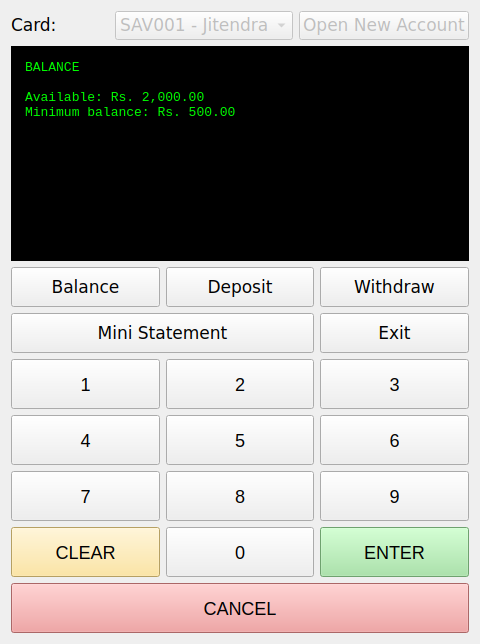

## Features

- Select a card and log in with a 4-digit PIN (the PIN is hidden as `****`)
- Card gets **blocked after 3 wrong PIN attempts**
- **Check balance** (also shows the minimum balance or the overdraft left, depending on the account type)
- **Deposit** and **Withdraw** using the on-screen keypad (buttons 0-9, CLEAR, ENTER, CANCEL)
- **Mini statement** showing the last 5 transactions
- **Open a new account** (Savings or Current) with a name, PIN and opening deposit
- Two account types with different rules:

| | Savings Account | Current Account |
|---|---|---|
| Minimum balance | Yes (default Rs. 500) | No |
| Overdraft | No | Yes (default limit Rs. 1000) |
| Minimum to open | Rs. 500 | Any amount, even 0 |
| Account number | `SAV001`, `SAV002`, ... | `CUR001`, `CUR002`, ... |

## Screenshots

<table>
  <tr>
    <td align="center">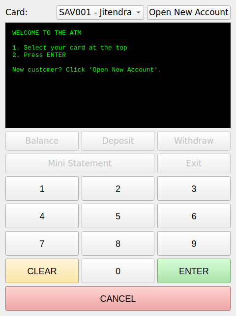</td>
    <td align="center">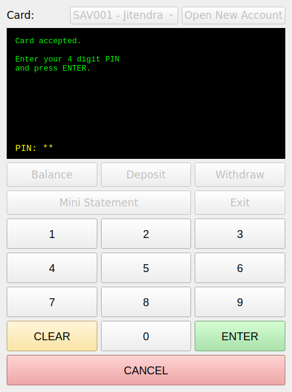</td>
    <td align="center">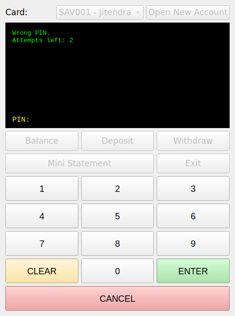</td>
  </tr>
  <tr>
    <td align="center">Welcome screen</td>
    <td align="center">PIN entry (hidden)</td>
    <td align="center">Wrong PIN</td>
  </tr>
  <tr>
    <td align="center">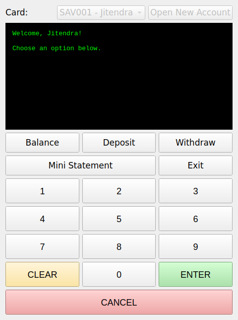</td>
    <td align="center">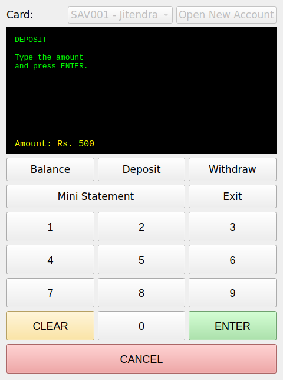</td>
    <td align="center">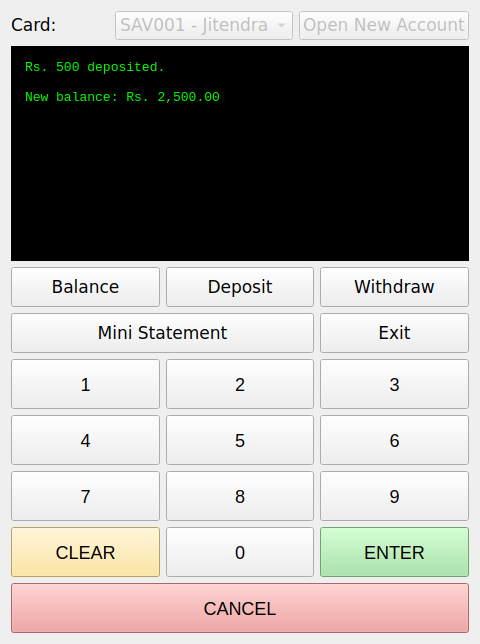</td>
  </tr>
  <tr>
    <td align="center">Main menu</td>
    <td align="center">Typing a deposit</td>
    <td align="center">Deposit done</td>
  </tr>
  <tr>
    <td align="center">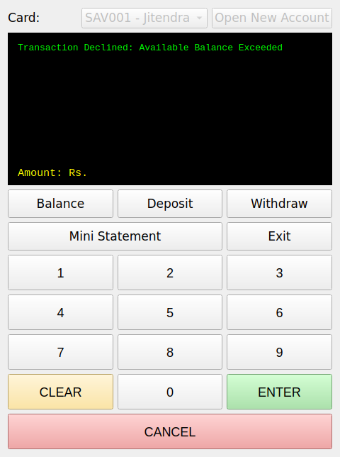</td>
    <td align="center">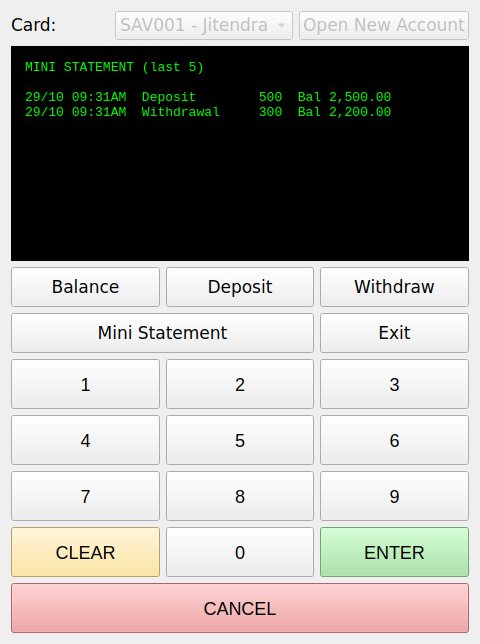</td>
    <td align="center">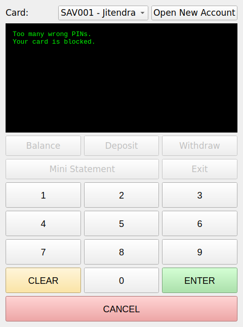</td>
  </tr>
  <tr>
    <td align="center">Withdraw declined (minimum balance)</td>
    <td align="center">Mini statement</td>
    <td align="center">Card blocked after 3 wrong PINs</td>
  </tr>
  <tr>
    <td align="center">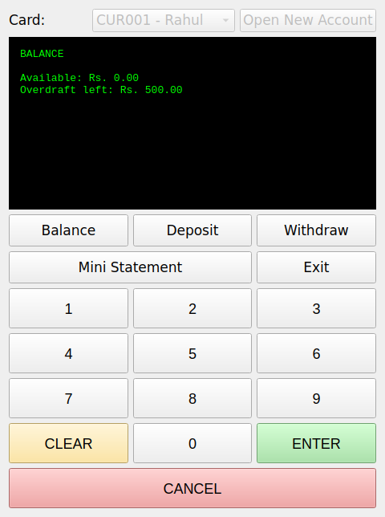</td>
    <td align="center">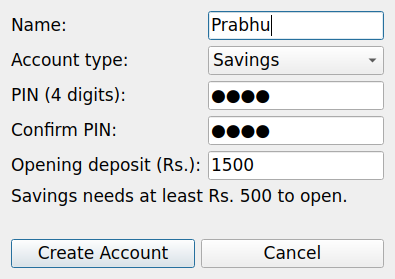</td>
    <td align="center">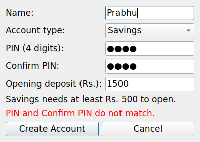</td>
  </tr>
  <tr>
    <td align="center">Current account using overdraft</td>
    <td align="center">Open New Account form</td>
    <td align="center">Form validation error</td>
  </tr>
  <tr>
    <td align="center">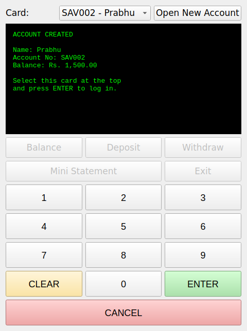</td>
  </tr>
  <tr>
    <td align="center">Account created</td>
  </tr>
</table>

## Requirements

- Python 3 (developed and tested with Python 3.12)
- PyQt5

## Installation

```bash
# 1. Clone the project
git clone https://github.com/<your-username>/Atm.git
cd Atm

# 2. (Optional) create a virtual environment
python -m venv venv

# Windows
venv\Scripts\activate
# Linux / macOS
source venv/bin/activate

# 3. Install the requirements
pip install -r requirements.txt
```

## How to run

Run this from the `Atm` folder (the folder that contains `main.py`):

```bash
python main.py
```

## How to use

Two demo accounts are created when the program starts:

| Card | Holder | Type | PIN | Starting balance |
|---|---|---|---|---|
| `SAV001` | Jitendra | Savings | `2480` | Rs. 2000 |
| `CUR001` | Rahul | Current | `1234` | Rs. 2000 |

1. Choose a card from the list at the top and press **ENTER**.
2. Type the PIN on the keypad and press **ENTER**.
3. Pick **Balance**, **Deposit**, **Withdraw** or **Mini Statement**.
4. For deposit / withdraw, type the amount and press **ENTER**.
5. Press **Exit** (or **CANCEL** on the menu) when you are done.

To create a new account, click **Open New Account** before logging in,
fill in the form, then select the new card from the list and log in with the PIN you chose.

Keypad buttons:

| Button | What it does |
|---|---|
| `0` - `9` | Types a digit (PIN or amount) |
| `CLEAR` | Removes everything typed so far |
| `ENTER` | Confirms the current step |
| `CANCEL` | Goes back one step, or logs out from the menu |

## Project structure

```
Atm/
├── main.py                     # creates the accounts and starts the window
├── requirements.txt
├── models/
│   ├── account.py              # base Account class
│   ├── savings.py              # SavingsAccount (minimum balance)
│   ├── current.py              # CurrentAccount (overdraft)
│   ├── transaction.py          # Transaction record (used by the mini statement)
│   └── customer.py
├── services/
│   ├── interest.py             # simple / compound interest functions
│   ├── auth_service.py         # login logic (work in progress)
│   └── bank_service.py         # planned
├── storage/                    # planned: saving data to files
├── utils/                      # planned: validators, exceptions, decorators
├── ui/
│   ├── app.py                  # main ATM window (PyQt5)
│   ├── new_account_dialog.py   # pop-up form to open a new account
│   └── ...                     # other planned screens
├── data/                       # for saved account data (ignored by git)
├── exports/                    # for exported statements (ignored by git)
└── docs/
    ├── screenshot.png
    └── screens/                # more screenshots used in this README
```

## How it works

- `main.py` builds the account objects and puts them in a dictionary
  (`account number -> account object`), then opens `ATMWindow(accounts)`.
- `ui/app.py` keeps track of which **state** the ATM is in
  (card, pin, menu, deposit, withdraw). The same `ENTER` button does a
  different job in each state.
- Deposits and withdrawals call the real methods of the account classes.
  A savings withdrawal that would go below the minimum balance raises a
  `ValueError`, and the UI shows that message on the screen.
- `ui/new_account_dialog.py` only collects and checks the form values.
  The account object itself is created in `ui/app.py`.

## Known limitations

- **Data is not saved.** Balances, new accounts and blocked cards are kept in
  memory only, so everything resets when the program is closed.
- The 3-attempt card block also resets when the program restarts.
- `models/transaction.py` contains test code at the bottom that runs
  whenever the file is imported, so extra lines may appear in the console.
- `CurrentAccount.withrawl()` does not check the overdraft limit by itself,
  so the check is done in `ui/app.py` for now.
- The interest functions in `services/interest.py` are written but not yet
  connected to the UI.

## Roadmap

- [ ] Save and load accounts and transactions from files (`storage/`)
- [ ] Use `AuthService` for login and temporary lockout
- [ ] Connect monthly interest to the UI
- [ ] Add unit tests with `pytest`
- [ ] Move the overdraft check into `CurrentAccount`
- [ ] Export statements to the `exports/` folder

## Authors

Jitendra and Prabhu

## License

Made for learning purposes.
